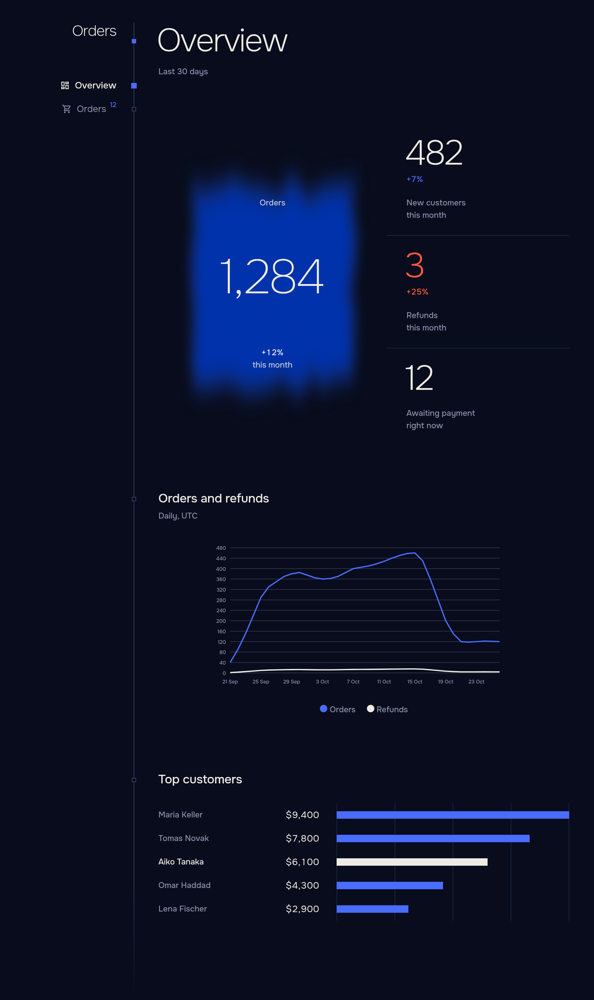
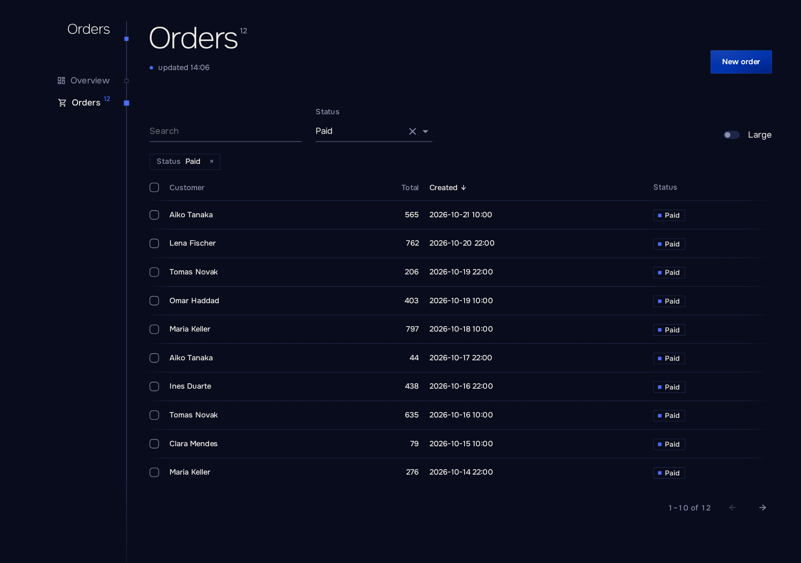
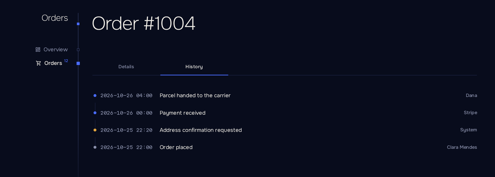

<div align="center">

# Enfilade

**A Blazor Server shell for admin panels.**
Register routable components as sections. Enfilade provides the navigation, theme, page chrome, dialogs, and error and reconnection handling.

**English** · [Русский](https://github.com/Echways/Enfilade/blob/main/README.ru.md)

[](https://www.nuget.org/packages/Enfilade)
[](https://github.com/Echways/Enfilade/actions/workflows/ci.yml)
[](https://github.com/Echways/Enfilade/blob/main/LICENSE)

</div>

```csharp
builder.Services.AddEnfilade()
    .AddSection<Home>("Home")
    .AddSection<Orders>("Orders");

app.MapEnfilade();
```



## Why Enfilade

An admin panel is mostly the same pages: a table, a form, a few numbers. Enfilade takes the work around them so a page stays a page.

- **One call per section.** A section is a Razor component with a route. Register it and it has a place in the navigation, a title, a 404 and an error boundary.
- **Tables that remember.** `Listing` keeps sorting, paging, search and filters in the address, so a link to a filtered view works for a colleague. It works over `IQueryable` in one line, EF Core included.
- **Forms without ceremony.** Inputs come from the model's types and data annotations. A changed form asks before it is closed or left.
- **Actions that behave.** `Button` confirms, blocks double clicks, reports success, shows a readable error and refreshes the page.
- **Rights where they already are.** Sections follow `[Authorize]` on their pages. What a user may not open is not in the menu.
- **Right time for everyone.** Times show in the viewer's time zone, data stays in UTC.
- **Calm when things break.** A failing page, count or load stays where it happened; the navigation keeps working. A dropped connection gets a reconnection dialog.
- **Looks finished.** Dark and light themes, your accent color, phone layouts with bottom sheets, keyboard and screen reader support. MudBlazor inputs, tables and menus match the theme.
- **English and Russian** out of the box, with a language switch.

## Installation

```shell
dotnet add package Enfilade
```

Requires .NET 10.

## Quick start

```csharp
using Enfilade;

var builder = WebApplication.CreateBuilder(args);

builder.Services.AddEnfilade(shell => shell.Brand = "Orders")
    .AddSection<Home>("Home")
    .AddSection<Orders>("Orders");

var app = builder.Build();
app.MapEnfilade();
app.Run();
```

Add the namespaces to `_Imports.razor`:

```razor
@using Enfilade
@using MudBlazor
```

A section is any routable component. A table with search and sorting:

```razor
@page "/orders"
@inject OrderStore Store

<PageHead />
<Listing TItem="Order" Load="Store.PageAsync" SearchBy="[order => order.Customer]" Sort="-createdAt">
    <Filters>
        <Search />
    </Filters>
    <Columns>
        <Cell Title="Customer" Value="order => order.Customer" Sort />
        <Cell Title="Total" Value="order => order.Total" Sort />
        <Cell Title="Created" Value="order => order.CreatedAt" Sort />
    </Columns>
</Listing>
```



## What is included

| Area | Highlights |
| ---- | ---------- |
| Navigation | Sections with icons and live counters, captions, account menu, language switch. |
| Listings | Server or in-memory data, filters, selection, live reload, loading, empty and error states. |
| Forms and dialogs | Side and bottom sheets, validation, field errors, unsaved-changes guard. |
| Blocks | Figures with change, line and bar charts, rankings, meters, tabs, timeline, facts. |
| Errors | Readable messages for your own exceptions, contained failures, retry. |
| Access | Host authentication, roles and policies, per-section visibility. |
| Formatting | Numbers, sizes, durations, ICU plurals, the viewer's time zone. |
| Extending | Section libraries, scoped CSS, design tokens as CSS variables. |



## Documentation

| | |
| - | - |
| [Getting started](https://github.com/Echways/Enfilade/blob/main/docs/en/getting-started.md) | Installation, the host, the first section |
| [Sections](https://github.com/Echways/Enfilade/blob/main/docs/en/sections.md) | Navigation, icons, counters |
| [Actions](https://github.com/Echways/Enfilade/blob/main/docs/en/actions.md) | `Button`, `Act`, `CurrentPage` |
| [Listings](https://github.com/Echways/Enfilade/blob/main/docs/en/listings.md) | Tables, filters, selection |
| [Dialogs and forms](https://github.com/Echways/Enfilade/blob/main/docs/en/forms.md) | Sheets, `Form`, `Field` |
| [Components](https://github.com/Echways/Enfilade/blob/main/docs/en/components.md) | Figures, charts, tabs and the rest |
| [Error messages](https://github.com/Echways/Enfilade/blob/main/docs/en/errors.md) | What users see on failure |
| [Formatting](https://github.com/Echways/Enfilade/blob/main/docs/en/formatting.md) | `Words`, `ViewerTime` |
| [Styling](https://github.com/Echways/Enfilade/blob/main/docs/en/styling.md) | Themes, accent, tokens |
| [Authentication](https://github.com/Echways/Enfilade/blob/main/docs/en/authentication.md) | Sign-in, roles, policies |
| [Localization](https://github.com/Echways/Enfilade/blob/main/docs/en/localization.md) | Languages and texts |
| [Configuration](https://github.com/Echways/Enfilade/blob/main/docs/en/configuration.md) | All options |
| [Section libraries](https://github.com/Echways/Enfilade/blob/main/docs/en/libraries.md) | Sections as packages |
| [Runtime behavior](https://github.com/Echways/Enfilade/blob/main/docs/en/runtime.md) | Refreshing, failures, reconnection |
| [Troubleshooting](https://github.com/Echways/Enfilade/blob/main/docs/en/troubleshooting.md) | Common messages and questions |

## License

[GPL-3.0](https://github.com/Echways/Enfilade/blob/main/LICENSE)
