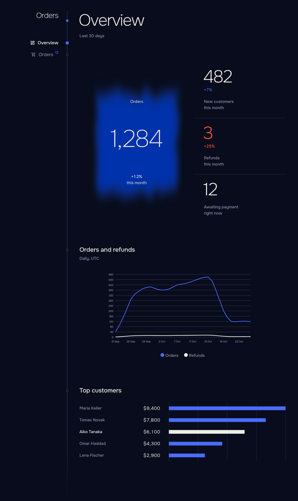
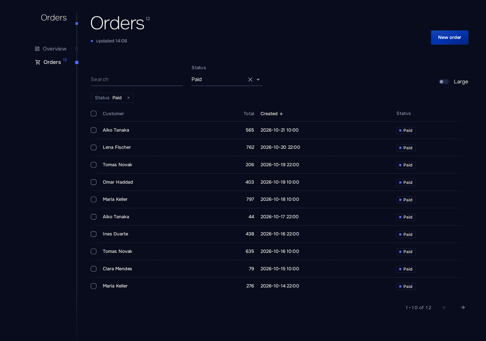
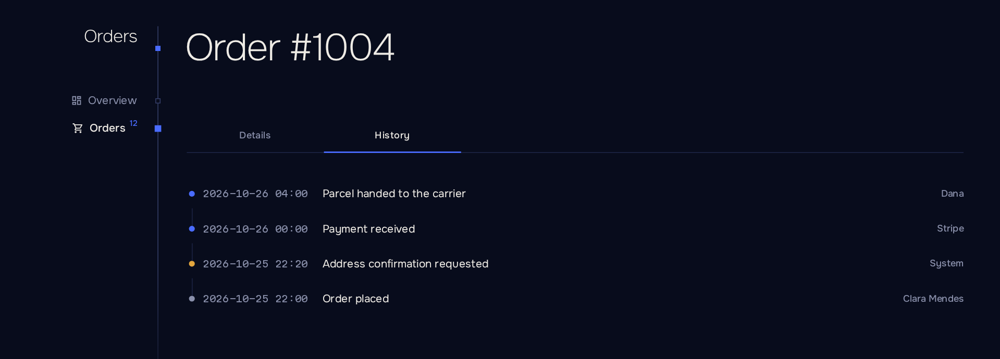

<div align="center">

# Enfilade

**Оболочка для админ-панелей на Blazor Server.**
Регистрируйте Razor-компоненты с маршрутами как разделы. Навигацию, тему, каркас страниц, диалоги, обработку ошибок и переподключения Enfilade берёт на себя.

[English](https://github.com/Echways/Enfilade/blob/main/README.md) · **Русский**

[](https://www.nuget.org/packages/Enfilade)
[](https://github.com/Echways/Enfilade/actions/workflows/ci.yml)
[](https://github.com/Echways/Enfilade/blob/main/LICENSE)

</div>

```csharp
builder.Services.AddEnfilade()
    .AddSection<Home>("Home")
    .AddSection<Orders>("Orders");

app.MapEnfilade();
```



## Зачем Enfilade

Админ-панель почти всегда состоит из одного и того же: таблица, форма, несколько чисел. Enfilade берёт на себя всё, что вокруг, чтобы страница оставалась просто страницей.

- **Один вызов на раздел.** Раздел — это Razor-компонент с маршрутом. После регистрации у него есть место в навигации, заголовок, страница 404 и защита от падений.
- **Таблицы, которые помнят состояние.** `Listing` хранит сортировку, страницу, поиск и фильтры в адресе, поэтому ссылка на отфильтрованный вид работает и у коллеги. Над `IQueryable`, включая EF Core, он подключается одной строкой.
- **Формы без церемоний.** Поля подбираются по типам модели и атрибутам данных. Изменённая форма спрашивает подтверждение, прежде чем закрыться или потерять данные.
- **Действия, которые ведут себя правильно.** `Button` спрашивает подтверждение, не даёт нажать дважды, сообщает об успехе, показывает понятную ошибку и обновляет страницу.
- **Права там, где они уже есть.** Разделы следуют `[Authorize]` на своих страницах. Что пользователю нельзя открыть, того нет и в меню.
- **Правильное время для каждого.** Время показывается в часовом поясе зрителя, а данные остаются в UTC.
- **Спокойствие при сбоях.** Упавшая страница, счётчик или загрузка остаются там, где случились; навигация продолжает работать. При обрыве соединения показывается диалог переподключения.
- **Выглядит законченно.** Тёмная и светлая темы, ваш акцентный цвет, мобильные макеты с нижними панелями, клавиатура и программы чтения с экрана. Инпуты, таблицы и меню MudBlazor оформлены под тему.
- **Английский и русский** из коробки, с переключателем языка.

## Установка

```shell
dotnet add package Enfilade
```

Требуется .NET 10.

## Быстрый старт

```csharp
using Enfilade;

var builder = WebApplication.CreateBuilder(args);

builder.Services.AddEnfilade(shell => shell.Brand = "Orders")
    .AddSection<Home>("Home")
    .AddSection<Orders>("Orders");

var app = builder.Build();
app.MapEnfilade();
app.Run();
```

Добавьте пространства имён в `_Imports.razor`:

```razor
@using Enfilade
@using MudBlazor
```

Раздел — любой компонент с маршрутом. Таблица с поиском и сортировкой:

```razor
@page "/orders"
@inject OrderStore Store

<PageHead />
<Listing TItem="Order" Load="Store.PageAsync" SearchBy="[order => order.Customer]" Sort="-createdAt">
    <Filters>
        <Search />
    </Filters>
    <Columns>
        <Cell Title="Customer" Value="order => order.Customer" Sort />
        <Cell Title="Total" Value="order => order.Total" Sort />
        <Cell Title="Created" Value="order => order.CreatedAt" Sort />
    </Columns>
</Listing>
```



## Что внутри

| Область | Возможности |
| ------- | ----------- |
| Навигация | Разделы с иконками и живыми счётчиками, заголовки групп, меню аккаунта, переключатель языка. |
| Списки | Данные с сервера или из памяти, фильтры, выбор строк, живое обновление, состояния загрузки, пустоты и ошибки. |
| Формы и диалоги | Боковые и нижние панели, валидация, ошибки у полей, защита от потери изменений. |
| Блоки | Показатели с динамикой, линейные и столбчатые графики, рейтинги, шкалы, вкладки, хронология, карточки фактов. |
| Ошибки | Понятные сообщения для ваших исключений, локализованные сбои, повтор. |
| Доступ | Аутентификация хоста, роли и политики, видимость разделов. |
| Форматирование | Числа, размеры, длительности, ICU-множественные, часовой пояс зрителя. |
| Расширение | Библиотеки разделов, изолированный CSS, токены дизайна в CSS-переменных. |



## Документация

| | |
| - | - |
| [Быстрый старт](https://github.com/Echways/Enfilade/blob/main/docs/ru/getting-started.md) | Установка, хост, первый раздел |
| [Разделы](https://github.com/Echways/Enfilade/blob/main/docs/ru/sections.md) | Навигация, иконки, счётчики |
| [Действия](https://github.com/Echways/Enfilade/blob/main/docs/ru/actions.md) | `Button`, `Act`, `CurrentPage` |
| [Списки](https://github.com/Echways/Enfilade/blob/main/docs/ru/listings.md) | Таблицы, фильтры, выбор строк |
| [Диалоги и формы](https://github.com/Echways/Enfilade/blob/main/docs/ru/forms.md) | Панели, `Form`, `Field` |
| [Компоненты](https://github.com/Echways/Enfilade/blob/main/docs/ru/components.md) | Показатели, графики, вкладки и остальное |
| [Сообщения об ошибках](https://github.com/Echways/Enfilade/blob/main/docs/ru/errors.md) | Что видит пользователь при сбое |
| [Форматирование](https://github.com/Echways/Enfilade/blob/main/docs/ru/formatting.md) | `Words`, `ViewerTime` |
| [Оформление](https://github.com/Echways/Enfilade/blob/main/docs/ru/styling.md) | Темы, акцентный цвет, токены |
| [Аутентификация](https://github.com/Echways/Enfilade/blob/main/docs/ru/authentication.md) | Вход, роли, политики |
| [Локализация](https://github.com/Echways/Enfilade/blob/main/docs/ru/localization.md) | Языки и тексты |
| [Настройка](https://github.com/Echways/Enfilade/blob/main/docs/ru/configuration.md) | Все параметры |
| [Библиотеки разделов](https://github.com/Echways/Enfilade/blob/main/docs/ru/libraries.md) | Разделы как пакеты |
| [Поведение во время работы](https://github.com/Echways/Enfilade/blob/main/docs/ru/runtime.md) | Обновление, сбои, переподключение |
| [Частые проблемы](https://github.com/Echways/Enfilade/blob/main/docs/ru/troubleshooting.md) | Типичные сообщения и вопросы |

## Лицензия

[GPL-3.0](https://github.com/Echways/Enfilade/blob/main/LICENSE)
