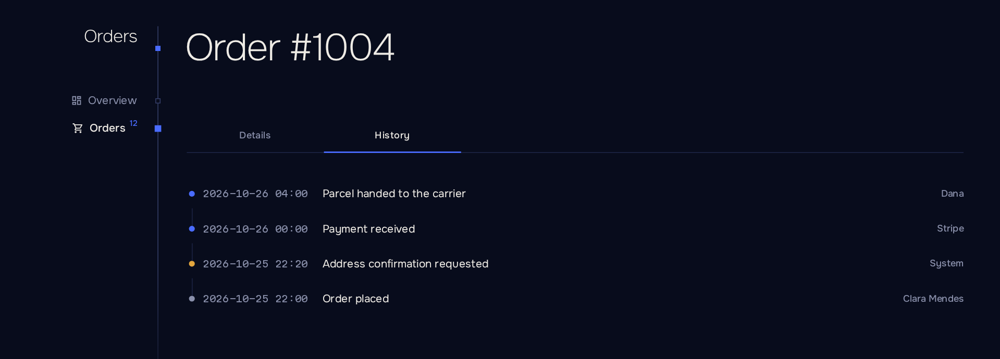
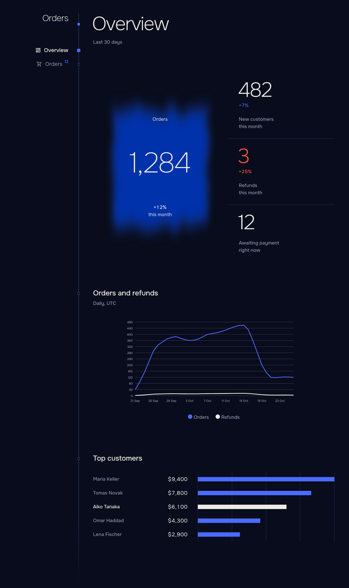

# Components

[English](components.md) · [Русский](../ru/components.md) · [Documentation](README.md)



| Component                    | Description                                                                                                           |
| ---------------------------- | --------------------------------------------------------------------------------------------------------------------- |
| `Facts`, `Fact`           | A record's labelled values: `<Fact Label="Total" Value="order.Total" />`, formatted by `ViewerTime.Of`, or own content. |
| `Tag`                      | A status label with `Tone`: `Neutral`, `Good`, `Warn` or `Bad`.                                        |
| `Notice`                   | An inline message with `Tone`, `Title`, content and `Actions`. Warnings and errors are announced as alerts.            |
| `Banner`                   | A `Notice` for the top of a page, square and tinted. `Dismissible` adds a close button; `OnDismiss` tells the host, which decides whether to remember it. |
| `Menu`, `MenuItem`         | A "⋯" menu for row actions, e.g. in a `Slot`. A `MenuItem` runs `OnClick` through `Act` and takes `Confirm`, `Done`, `Refresh`, `Danger` and `Disabled` like `Button`. For links use `MudMenuItem`. |
| `Steps`                    | A vertical progress of a process from `Step(Title, State, Detail)`; `State` is `Pending`, `Current`, `Done` or `Failed`. |
| `Wizard`, `WizardStep`     | A multi-step flow: `Steps` and the open `WizardStep` (`Title`, `Detail`, `OnLeave`) with Back, Next and Finish. `@bind-Current`, `OnFinish`, `Done`, `Confirm`. See below. |
| `Tabs`, `Tab`              | Tabs whose choice lives in the address (`tab=`, or `Name`). A `Tab` has `Title` and optional `Name`; only the open tab renders. |
| `Timeline`                 | Events from `TimelineEntry(At, Text, Who, Tone)`, newest first, in the viewer's time zone.              |
| `Pane`                     | A titled section of a page with `Hint` and `Actions`.                                                    |
| `Setting`                  | A settings row: `Title`, `Hint` and the control on the right. Group rows in `<div class="settings">`. |
| `EmptyState`               | An empty state: `Title`, `Hint` and an optional action.                                                  |
| `PageHead`                 | Page title with `Count`, `Summary`, `UpdatedAt` with `OnRefresh`, and `Actions`. Without `Count` and `UpdatedAt` it follows the page's listings. |
| `Placeholder`              | Skeleton for content that is still loading.                                                                           |
| `AutoRefresh`              | Invokes `OnTick` every `AutoRefreshInterval` while the tab is visible.                                            |
| `Sheet`                    | Layout for a sheet: `ChildContent` and `Actions`.                                                                 |
| `Figure`                   | Large number with two caption lines (`First`, `Second`). `Alarm` marks it red. `Change` (a share: `0.12` is +12%) shows the change to the previous period, good when it grows unless `LowerIsBetter`. `Spark` adds a small line of recent values. Group in `<div class="figs">`. |
| `Chart`                    | A line or bar chart over time from `Trend(Name, Readings)` of `Reading(At, Value)`. See below.                        |
| `Strips`                   | Horizontal bars for a ranking, from `Strip(Label, Value, Shown)`.                                                   |
| `Sparkline`                | A tiny chart for a table cell or a caption from `Values`: a line with its last point marked, or `Bars`. `Tone` colors it; `Summary` makes it an image for screen readers, without it it is decoration. |
| `Meter`                    | `Used / Limit` with a bar that turns ochre at 90% and red at 100%.                                                  |
| `Crumb`                    | Removable filter chip that links to the address without the filter.                                                   |
| `CopyLine`, `CopyButton` | A value with a copy button.                                                                                           |
| `Output`                   | A bordered box for logs and command output: `Text` and `Empty`, the line shown when there is no text.                 |
| `Adder`                    | A one-line add form: `Placeholder`, `OnAdd` with the trimmed text, `Done`, and the button label as content. Enter adds too. |
| `KeyField`                 | A secret token in groups, with a copy button.                                                                         |
| `EntranceLayout`           | Full-screen layout without navigation, for sign-in pages: `@layout EntranceLayout`.                                 |
| `LanguageLink`             | Link to the next language, for pages outside the shell.                                                               |

MudBlazor inputs, selects, switches, checkboxes, tables, menus and snackbars are themed, so the two libraries mix without visible seams.

## An overview page

Figures, a chart and a ranking make a dashboard in one component:



```razor
@page "/"
@inject OrderStore Store

<PageHead />

<div class="figs">
    <Figure Value="_today" First="Orders" Second="today" Change="0.12" />
    <Figure Value="_refunds" First="Refunds" Second="today" Change="0.04" LowerIsBetter Alarm="_refunds > 20" />
    <Figure Text="98.2%" First="Paid" Second="last 30 days" />
</div>

<Pane Title="Orders" Hint="Last 30 days">
    <Chart Trends="[new Trend("Orders", _orders), new Trend("Refunds", _refundsSeries)]"
           Step="Period.Day" From="_monthAgo" To="_now" />
</Pane>

<Pane Title="Top customers">
    <Strips Items="_customers" />
</Pane>
```

`Figure` takes a number in `Value` or a ready string in `Text`.

## Chart

```razor
<Chart Trends="[new Trend("Orders", _orders), new Trend("Refunds", _refunds)]" Step="Period.Day" From="_monthAgo" To="_now" />
```

| Parameter         | Description                                                                                  |
| ----------------- | -------------------------------------------------------------------------------------------- |
| `Trends`        | Series of readings. Readings in one bucket are summed; empty buckets are zero.              |
| `Kind`          | `Line` (default) or `Bars`.                                                                |
| `Step`          | `Hour`, `Day` (default), `Week` (from Monday) or `Month`, bounded in the viewer's time zone. |
| `From`, `To`  | Extend the axis beyond the readings.                                                         |
| `Format`        | Axis values. Default: whole numbers by `Words.Number`.                                     |
| `Height`        | Pixels. Default `240`.                                                                     |

## Strips and meters

`Strips` draws a ranking. `Strip(Label, Value, Shown, Detail, Lit)` carries the bar's length (`Value`), the text at its end (`Shown`), a tooltip (`Detail`) and a highlight (`Lit`). Bars scale to the largest value; pass `Peak` to fix the scale and `Wide` for a wider label column.

```razor
<Strips Items="[new Strip("Acme", 4200, "4,200"), new Strip("Globex", 2900, "2,900", Lit: true)]" />
```

`Meter` shows consumption against a limit and is meant for table cells:

```razor
<Slot Title="Seats"><Meter Used="context.Seats" Limit="context.Plan.Seats" /></Slot>
```

Without a `Limit` it shows the number alone.

## Tabs and timeline

```razor
<Tabs>
    <Tab Title="Details">
        <Facts>
            <Fact Label="Customer" Value="_order.Customer" />
            <Fact Label="Total" Value="_order.Total" />
            <Fact Label="Created" Value="_order.CreatedAt" />
        </Facts>
    </Tab>
    <Tab Title="History" Name="history">
        <Timeline Entries="_events" />
    </Tab>
</Tabs>
```

The open tab is `?tab=history` in the address, so a link opens the page on the right tab and Back works as expected. Two `Tabs` on one page need distinct `Name`s.


## Row menu

A `Menu` is a "⋯" button for the actions of one row. Put it in a `Slot`; clicking it does not open the row. An item runs through `Act` like a `Button`, so a confirmation, the "done" message, failure handling and the page refresh come with it:

```razor
<Slot Title="">
    <Menu>
        <MenuItem OnClick="() => ArchiveAsync(context)" Done="Archived">Archive</MenuItem>
        <MenuItem OnClick="() => DeleteAsync(context)" Danger
                  Confirm="@(new Confirm("Delete the order?", "It cannot be restored.", "Delete", Danger: true))">Delete</MenuItem>
    </Menu>
</Slot>
```

`Label` names the button for screen readers (default "Row actions"). For a link, use `MudMenuItem Href`.

## Wizard

A `Wizard` shows `Steps` next to the open step and the buttons that move between them. Only the open `WizardStep` renders. `Current` is the index of the open step; bind it with `@bind-Current` to read or set it, or leave it out and the wizard keeps it itself.

```razor
<Wizard @bind-Current="_step" OnFinish="CreateAsync" Done="Order created">
    <WizardStep Title="Customer" Detail="@_draft.Customer" OnLeave="CheckCustomer">
        <MudTextField @bind-Value="_draft.Customer" Label="Customer" />
    </WizardStep>
    <WizardStep Title="Delivery">
        <MudTextField @bind-Value="_draft.Address" Label="Address" />
    </WizardStep>
</Wizard>

@code {
    private void CheckCustomer()
    {
        if (string.IsNullOrWhiteSpace(_draft.Customer))
            throw new PanelException("Enter the customer");
    }
}
```

`OnLeave` runs when the user presses "Next", or "Finish" on the last step. A `PanelException` keeps the user on the step, marks it failed in the header and shows its message. "Next" never reloads the page. "Finish" runs `OnFinish` through `Act`, so `Done`, `Confirm` and `Refresh` work as on a `Button`; `Finish` changes its label. Back is always free.
