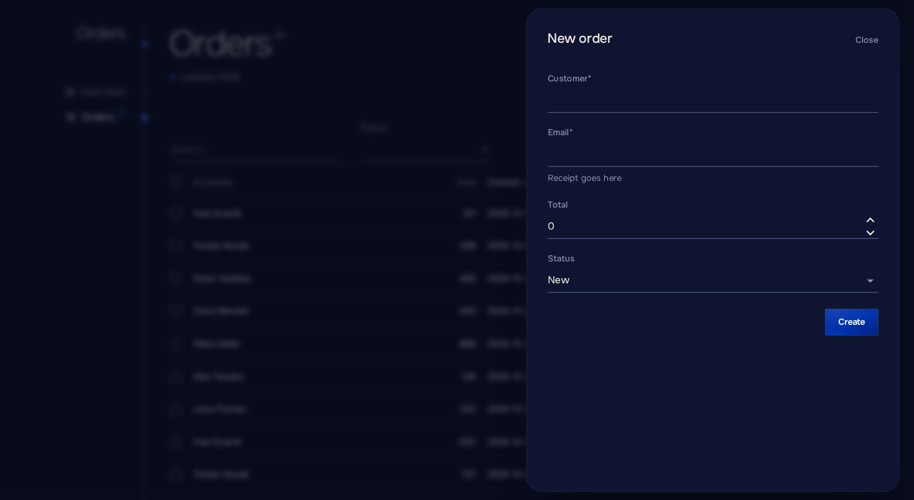

# Dialogs and forms

[English](forms.md) · [Русский](../ru/forms.md) · [Documentation](README.md)

## Dialogs

```csharp
if (await Dialogs.ConfirmAsync("Delete the order?", "The customer is notified.", "Delete", danger: true))
    await Store.DeleteAsync(order);

var sheet = await Dialogs.ShowSheetAsync<OrderForm>("New order");
var result = await sheet.Result;
```

`ShowSheetAsync` opens a side sheet on desktop and a bottom sheet on phones. With the default `form: true`, a click outside the sheet does not close it. Pass `form: false` for read-only details. A sheet component wraps its markup in `Sheet`, which has `ChildContent` and `Actions`.

For a plain confirmation before an action, `Button` with `Confirm` is shorter; see [Actions](actions.md).

## Forms

```razor
<Sheet>
    <Form Model="_order" OnSubmit="SaveAsync" Submit="Create" Done="Order created">
        <Field For="() => _order.Customer" />
        <Field For="() => _order.Total" />
        <Field For="() => _order.Status" />
    </Form>
</Sheet>

@code {
    private readonly OrderDraft _order = new();

    private Task SaveAsync() => Store.CreateAsync(_order);
}
```

```csharp
var order = await Dialogs.ShowFormAsync<OrderSheet, OrderDraft>("New order");
```



`Form` validates with data annotations, shows a busy submit button and submits once on Enter. On success it reports `Done`, reloads the page's blocks, and inside a sheet closes it with the model, which `ShowFormAsync` returns; a closed sheet returns `null`.

The model is an ordinary class with data annotations:

```csharp
public sealed class OrderDraft
{
    [Required, Display(Name = "Customer", Description = "As on the invoice")]
    public string Customer { get; set; } = "";

    [Range(1, 100_000)]
    public decimal Total { get; set; }

    public OrderStatus Status { get; set; }
}
```

## Errors and unsaved changes

- `OnSubmit` throws `FieldException(field, message)` or `FieldException(errors)` for errors next to fields; they clear when the field changes.
- A `PanelException` or a [registered](errors.md) exception shows its message above the button; any other exception shows a general message and is logged.
- A changed form asks before its sheet closes (the close button or Escape) and before the page is left. A change is any difference from the model as it was given to the form or last saved, compared by its JSON snapshot, so rows added to or removed from a collection count, and a value changed back does not. Mark a property `[JsonIgnore]` to leave it out. Give the form a new model instance to start over.
- `IsDirty` on a `@ref` tells whether the form has changes, for example before switching views inside a page, which is not navigation.
- Any MudBlazor input with `For=` works inside `Form`, and `Form` works on a page too, for example in settings.

## Form parameters

| Parameter        | Description                                                     |
| ---------------- | --------------------------------------------------------------- |
| `Model`        | The edited object.                                              |
| `OnSubmit`     | Called with a valid model.                                      |
| `Submit`       | Text of the submit button. Default "Save".                      |
| `Done`         | Message after success. Default "Saved".                         |
| `Refresh`      | Reloads the page's blocks after success. Default `true`.      |
| `Actions`      | More buttons before the submit button.                          |

## Fields

`Field` picks the input from the property type and takes its label from `[Display(Name)]` (resources included), its hint from `[Display(Description)]` and its required mark from `[Required]`.

| Type                                    | Input                                                    |
| --------------------------------------- | -------------------------------------------------------- |
| `string`                              | Text; `Lines` for several lines, `Secret` for a password. |
| Numbers                                 | Numeric field.                                           |
| `bool`, `bool?`                     | Switch, three-state checkbox.                            |
| Enums, or any type with `Options`     | Select with the `[Display(Name)]` of each member.       |
| `DateOnly`                            | Date.                                                    |
| `DateTime`, `DateTimeOffset`        | Date and time in the viewer's time zone, saved in UTC.  |

| Parameter        | Description                                                     |
| ---------------- | --------------------------------------------------------------- |
| `For`          | `() => _order.Customer`.                                      |
| `Label`, `Hint` | Override the attributes.                                     |
| `Options`      | `Option(Value, Title)` choices, for example for a `string`. |
| `Lines`, `Secret`, `Disabled` | Text input settings.                            |

Another type fails with a message that points to MudBlazor inputs.
