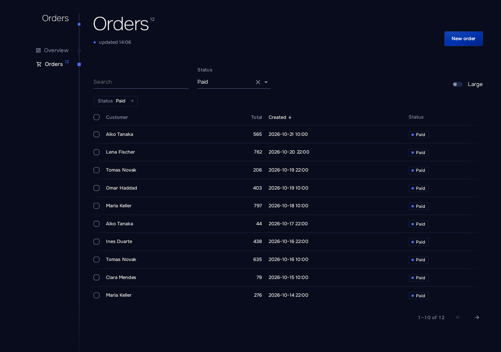

# Listings

[English](listings.md) · [Русский](../ru/listings.md) · [Documentation](README.md)

`Listing` shows a table with sorting, paging, filters and the loading, empty and error states. Its state lives in the address, so a link to a filtered page can be sent to a colleague.

```razor
<PageHead />
<Listing TItem="Order" Load="Store.PageAsync" Sort="-createdAt" Href="@(order => $"orders/{order.Id}")">
    <Columns>
        <Cell Title="Customer" Value="order => order.Customer" Sort />
        <Cell Title="Total" Value="order => order.Total" Sort />
        <Cell Title="Created" Value="order => order.CreatedAt" Sort />
        <Slot Title="Status"><Tag Tone="ToneOf(context)">@context.Status</Tag></Slot>
    </Columns>
</Listing>
```



## Loading data

A server-side `Load` gets a `ListQuery<TItem>` with resolved expressions, so a store over `IQueryable` (EF Core included) stays one line:

```csharp
public Task<ListPage<Order>> PageAsync(ListQuery<Order> query, CancellationToken token) =>
    Task.FromResult(db.Orders.ToPage(query));
```

`Filter(query)` applies the conditions, `Slice(query)` the order and the page, `ToPage(query)` both plus the count. For other stores the query also carries the raw values: `Page`, `Size`, `Search`, `Sort` (`Key`, `Descending`) and `Filters` by name.

Pass `Items` instead of `Load` to let the listing sort, filter and page an in-memory collection.

| Parameter        | Description                                                                                  |
| ---------------- | -------------------------------------------------------------------------------------------- |
| `Load`         | `(ListQuery<TItem>, CancellationToken) => Task<ListPage<TItem>>`. A newer load cancels an older one. |
| `Items`        | An in-memory collection. Exactly one of `Load` and `Items` is required.                  |
| `Columns`      | `Cell` and `Slot` components.                                                            |
| `Href`         | A row link: middle click and "open in a new tab" work.                                     |
| `OnOpen`       | Called with the row's item on click or Enter, for example to open a sheet.                   |
| `Sort`         | Default sort key, `-` for descending: `"-total"`.                                       |
| `PageSize`     | Rows per page, at least `1`. Default `25`.                                                 |
| `Name`         | Prefix of the address keys, for two listings on one page: `orders.page`.                   |
| `Empty`        | Content shown when there is nothing yet.                                                     |
| `Dense`        | Tighter rows.                                                                                |

## Columns

`Cell` shows a value formatted by `ViewerTime.Of`: numbers, money, dates in the viewer's time zone, durations, `bool` and enums with `[Display(Name)]`.

| Parameter        | Description                                                                                  |
| ---------------- | -------------------------------------------------------------------------------------------- |
| `Title`        | Column heading.                                                                              |
| `Value`        | `order => order.Total`. Its member path, in camel case, is the sort key in the address.   |
| `Sort`         | Makes the column sortable. A computed `Value` also needs `Key`.                          |
| `Number`       | Right-aligns the column. Default: on for numeric values.                                     |
| `Format`       | Own formatting of the value.                                                                 |
| `ChildContent` | A template with `context`; the value still sorts.                                          |

`Slot` is a template-only column, such as actions; it never sorts.

## Filters

```razor
<Listing TItem="Order" Load="Store.PageAsync" SearchBy="[order => order.Customer, order => order.Email]">
    <Filters>
        <Search />
        <Choice Title="Status" By="order => order.Status" Options="Statuses" />
        <Flag Title="Large" Name="large" Where="order => order.Total > 1000" />
    </Filters>
    <Columns>...</Columns>
</Listing>
```

Active filters appear as `Crumb`s that remove them. When filters leave nothing, the listing says so and links to the address without them. A filter change returns to the first page.

| Filter    | Parameters                                                                                                                       |
| --------- | -------------------------------------------------------------------------------------------------------------------------------- |
| `Search` | `Placeholder`. Case-insensitive "contains" over the listing's `SearchBy`, after typing pauses for 300 ms; it replaces the history entry instead of adding one. In-memory listings need `SearchBy`; a server `Load` without it gets the text in `query.Search`. |
| `Choice` | `Title`, `By` (`order => order.Status`), `Options` (`Option(Value, Title)`), `Name` (default: the member path of `By`). |
| `Flag`   | `Title`, `Name`, `Where` (`order => order.Total > 1000`). On is `name=1` in the address.                                  |

Two filters with one name fail on the first render. An address value that matches no option is ignored.

## The address

The address keys are `page`, `sort`, `q` and the filter names. With `Name="orders"` they become `orders.page`, `orders.sort` and so on.

A hand-edited address never breaks the page: a bad page number opens the first page, a page past the end opens the last one, an unknown sort key falls back to the default sort. A sortable cell without a member path fails on the first render with a message naming the cell.

## Selection and freshness

```razor
<PageHead />
<Listing TItem="Order" Load="Store.PageAsync" ItemKey="order => order.Id" Selectable Live>
    <Selected>
        <Button Kind="ButtonKind.Danger" OnClick="() => Store.CancelAsync(context)" Done="Orders cancelled">Cancel</Button>
    </Selected>
    <Columns>...</Columns>
</Listing>
```

| Parameter    | Description                                                                                               |
| ------------ | --------------------------------------------------------------------------------------------------------- |
| `Selectable` | Adds checkboxes. The selection covers the current page and clears when the page, sort or filters change. |
| `Selected`   | A bar above the table while rows are selected; `context` is the selected items.                          |
| `ItemKey`    | What identifies a row, so the selection survives a reload: `order => order.Id`. Default: the item itself, which only works for items that compare by value, such as records; a selectable listing with `Load` of other classes requires it. |
| `Live`       | Reloads every `AutoRefreshInterval` while the tab is visible.                                             |

`PageHead` without `Count` and `UpdatedAt` follows the page: it shows the total and the time of the last load of the first listing on the page, and its refresh stamp reloads every listing. An action run through `Button` or `Act` reloads them too.

The first load shows a skeleton; a reload keeps the rows on screen; a failed load shows a message and a retry inside the listing while the rest of the page keeps working. The message is the exception's own when it is [shown to users](errors.md), and a general one otherwise. Call `RefreshAsync()` on a `@ref` to reload from code.
