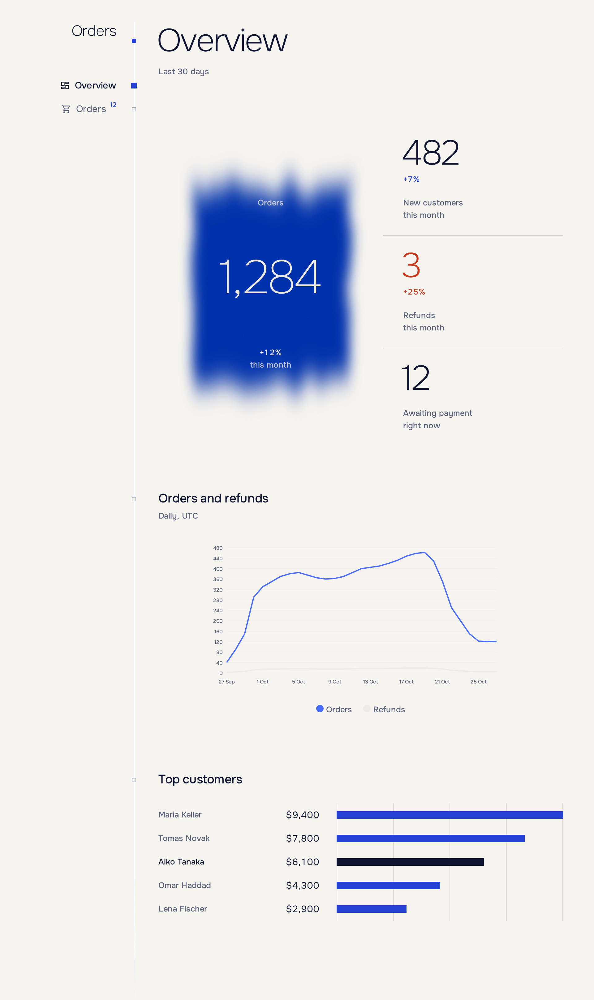

# Styling

[English](styling.md) · [Русский](../ru/styling.md) · [Documentation](README.md)

Dark is the default; `Light` and `System` are one option away.

```csharp
builder.Services.AddEnfilade(shell =>
{
    shell.Appearance = Appearance.System;
    shell.Accent = "#2F5BFF";
});
```



## Design tokens

Design tokens are CSS custom properties: `--night`, `--deep`, `--rule`, `--mist`, `--light`, `--klein`, `--glow`, `--vermilion`, `--ochre`, `--sans`, `--mono`. With `Appearance` set to `Light` (or `System` on a light device) they keep their names and take light values: `--night` becomes the light background and `--light` the dark text.

Use the tokens in your own stylesheets and they follow the theme:

```css
.callout {
    border: 1px solid var(--rule);
    background: var(--deep);
    color: var(--light);
}
```

`Accent` replaces the brand color (`--klein`) with your own `#RRGGBB`. Add stylesheets with `AddStylesheet(path)`; scoped CSS of sections is linked automatically.

## Classes

| Class                                         | Use                                              |
| --------------------------------------------- | ------------------------------------------------ |
| `btn-k pigment`                             | Primary button.                                  |
| `btn-danger`                                | Destructive button.                              |
| `link`                                      | Quiet text button.                               |
| `tbl`, `tbl dense`                        | On `MudTable`. Add `num` to numeric columns. |
| `empty`                                     | Empty state; `EmptyState` renders it.          |
| `block`, `lead`                           | Titled section further down a page; `Pane` replaces them. |
| `group`, `pair`, `hint`, `form-error` | Form layout inside a sheet.                      |
| `note`, `warn-t`, `bad-t`               | Secondary, warning and error text.               |
| `sr`                                        | Visible to screen readers only.                  |

## Accessibility

- After navigation, focus moves to the page heading.
- Layouts honor safe-area insets, coarse pointers and `prefers-reduced-motion`.
- Figures and filter chips carry text for screen readers; `sr` does the same for your own markup.
