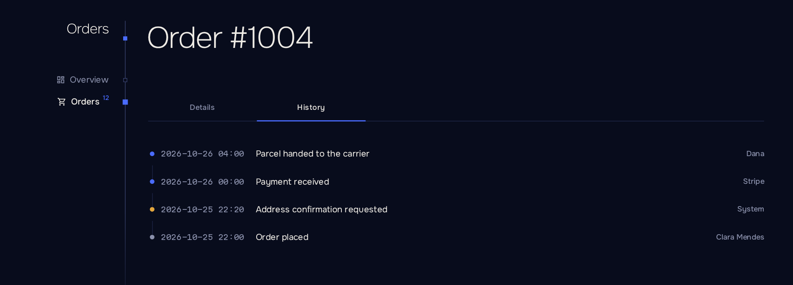
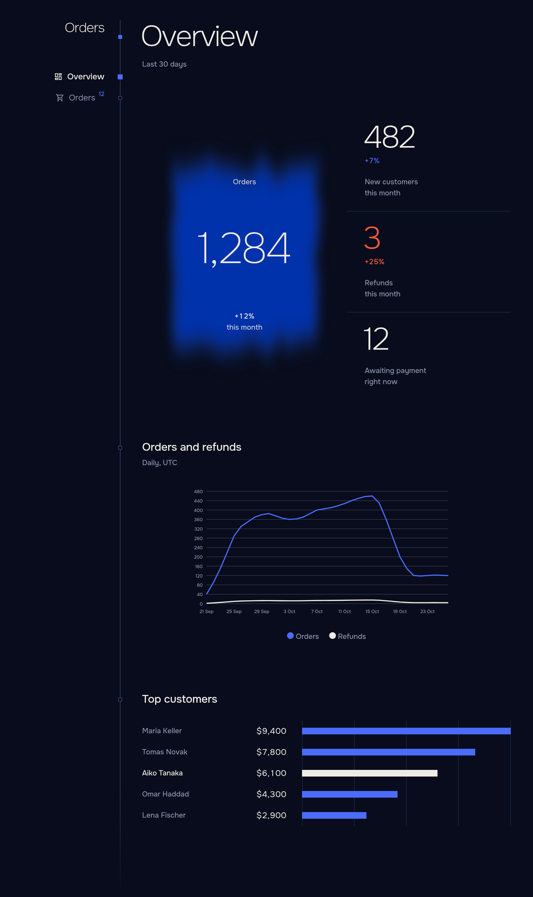

# Компоненты

[English](../en/components.md) · [Русский](components.md) · [Документация](README.md)



| Компонент                    | Описание                                                                                                              |
| ---------------------------- | --------------------------------------------------------------------------------------------------------------------- |
| `Facts`, `Fact`           | Подписанные значения записи: `<Fact Label="Total" Value="order.Total" />`, форматируются через `ViewerTime.Of`, либо собственное содержимое. |
| `Tag`                      | Метка статуса с `Tone`: `Neutral`, `Good`, `Warn` или `Bad`.                                           |
| `Notice`                   | Встроенное сообщение с `Tone`, `Title`, содержимым и `Actions`. Предупреждения и ошибки озвучиваются как alert.        |
| `Banner`                   | `Notice` для верха страницы: прямоугольный и подкрашенный. `Dismissible` добавляет кнопку закрытия, `OnDismiss` сообщает хосту, запоминать ли закрытие. |
| `Menu`, `MenuItem`         | Меню «⋯» для действий над строкой, например в `Slot`. `MenuItem` выполняет `OnClick` через `Act` и принимает `Confirm`, `Done`, `Refresh`, `Danger` и `Disabled`, как `Button`. Для ссылок используйте `MudMenuItem`. |
| `Steps`                    | Вертикальный ход процесса из `Step(Title, State, Detail)`; `State` — `Pending`, `Current`, `Done` или `Failed`.      |
| `Wizard`, `WizardStep`     | Многошаговый сценарий: `Steps` и открытый `WizardStep` (`Title`, `Detail`, `OnLeave`) с кнопками «Назад», «Далее» и «Готово». `@bind-Current`, `OnFinish`, `Done`, `Confirm`. См. ниже. |
| `Tabs`, `Tab`              | Вкладки, выбор которых хранится в адресе (`tab=` или `Name`). У `Tab` есть `Title` и необязательный `Name`; рендерится только открытая вкладка. |
| `Timeline`                 | События из `TimelineEntry(At, Text, Who, Tone)`, новые сверху, в часовом поясе зрителя.                  |
| `Pane`                     | Блок страницы с заголовком, `Hint` и `Actions`.                                                          |
| `Setting`                  | Строка настроек: `Title`, `Hint` и элемент управления справа. Строки группируются в `<div class="settings">`. |
| `EmptyState`               | Пустое состояние: `Title`, `Hint` и необязательное действие.                                             |
| `PageHead`                 | Заголовок страницы с `Count`, `Summary`, `UpdatedAt` с `OnRefresh` и `Actions`. Без `Count` и `UpdatedAt` следует за списками страницы. |
| `Placeholder`              | Скелетон для содержимого, которое ещё загружается.                                                                    |
| `AutoRefresh`              | Вызывает `OnTick` каждые `AutoRefreshInterval`, пока вкладка видна.                                              |
| `Sheet`                    | Разметка панели: `ChildContent` и `Actions`.                                                                      |
| `Figure`                   | Крупное число с двумя строками подписи (`First`, `Second`). `Alarm` окрашивает его в красный. `Change` (доля: `0.12` — это +12%) показывает изменение к прошлому периоду, хорошее при росте, если не задан `LowerIsBetter`. `Spark` добавляет маленькую линию последних значений. Группируется в `<div class="figs">`. |
| `Chart`                    | Линейный или столбчатый график по времени из `Trend(Name, Readings)` с `Reading(At, Value)`. См. ниже.            |
| `Strips`                   | Горизонтальные полосы для рейтинга из `Strip(Label, Value, Shown)`.                                                |
| `Sparkline`                | Крошечный график для ячейки таблицы или подписи из `Values`: линия с отмеченной последней точкой или `Bars`. `Tone` задаёт цвет, `Summary` делает его картинкой для скринридера, без него это украшение. |
| `Meter`                    | `Used / Limit` с полосой, которая желтеет на 90% и краснеет на 100%.                                               |
| `Crumb`                    | Снимаемая метка фильтра, ссылка на адрес без этого фильтра.                                                           |
| `CopyLine`, `CopyButton` | Значение с кнопкой копирования.                                                                                       |
| `Output`                   | Блок с рамкой для логов и вывода команд: `Text` и `Empty` — строка, когда текста нет.                                 |
| `CodeEditor`               | Редактор кода на CodeMirror: `Value` — начальный текст, `Language` (`python`) включает подсветку, `ReadOnly` запрещает правку. `OnChange` срабатывает на каждую правку; текст читает `GetValueAsync()`, заменяет `SetValueAsync()`. Высота задаётся `.code-editor`. |
| `Adder`                    | Однострочная форма добавления: `Placeholder`, `OnAdd` с обрезанным текстом, `Done` и подпись кнопки в содержимом. Enter тоже добавляет. |
| `KeyField`                 | Секретный токен группами с кнопкой копирования.                                                                       |
| `EntranceLayout`           | Полноэкранный макет без навигации для страниц входа: `@layout EntranceLayout`.                                      |
| `LanguageLink`             | Ссылка на следующий язык для страниц вне оболочки.                                                                    |

Инпуты, выпадающие списки, переключатели, флажки, таблицы, меню и уведомления MudBlazor оформлены в той же теме, поэтому две библиотеки сочетаются без видимых швов.

## Страница-обзор

Показатели, график и рейтинг собирают дашборд из нескольких компонентов:



```razor
@page "/"
@inject OrderStore Store

<PageHead />

<div class="figs">
    <Figure Value="_today" First="Orders" Second="today" Change="0.12" />
    <Figure Value="_refunds" First="Refunds" Second="today" Change="0.04" LowerIsBetter Alarm="_refunds > 20" />
    <Figure Text="98.2%" First="Paid" Second="last 30 days" />
</div>

<Pane Title="Orders" Hint="Last 30 days">
    <Chart Trends="[new Trend("Orders", _orders), new Trend("Refunds", _refundsSeries)]"
           Step="Period.Day" From="_monthAgo" To="_now" />
</Pane>

<Pane Title="Top customers">
    <Strips Items="_customers" />
</Pane>
```

`Figure` принимает число в `Value` или готовую строку в `Text`.

## Chart

```razor
<Chart Trends="[new Trend("Orders", _orders), new Trend("Refunds", _refunds)]" Step="Period.Day" From="_monthAgo" To="_now" />
```

| Параметр          | Описание                                                                                     |
| ----------------- | -------------------------------------------------------------------------------------------- |
| `Trends`        | Серии показаний. Показания в одном интервале суммируются; пустые интервалы равны нулю.      |
| `Kind`          | `Line` (по умолчанию) или `Bars`.                                                          |
| `Step`          | `Hour`, `Day` (по умолчанию), `Week` (с понедельника) или `Month`, границы в часовом поясе зрителя. |
| `From`, `To`  | Расширяют ось за пределы показаний.                                                          |
| `Format`        | Значения оси. По умолчанию целые числа через `Words.Number`.                               |
| `Height`        | В пикселях. По умолчанию `240`.                                                            |

## Strips и Meter

`Strips` рисует рейтинг. `Strip(Label, Value, Shown, Detail, Lit)` несёт длину полосы (`Value`), текст на её конце (`Shown`), подсказку (`Detail`) и подсветку (`Lit`). Полосы масштабируются по наибольшему значению; чтобы зафиксировать масштаб, передайте `Peak`, а для более широкой колонки подписей — `Wide`.

```razor
<Strips Items="[new Strip("Acme", 4200, "4,200"), new Strip("Globex", 2900, "2,900", Lit: true)]" />
```

`Meter` показывает расход относительно лимита и рассчитан на ячейки таблицы:

```razor
<Slot Title="Seats"><Meter Used="context.Seats" Limit="context.Plan.Seats" /></Slot>
```

Без `Limit` он показывает одно число.

## Вкладки и хронология

```razor
<Tabs>
    <Tab Title="Details">
        <Facts>
            <Fact Label="Customer" Value="_order.Customer" />
            <Fact Label="Total" Value="_order.Total" />
            <Fact Label="Created" Value="_order.CreatedAt" />
        </Facts>
    </Tab>
    <Tab Title="History" Name="history">
        <Timeline Entries="_events" />
    </Tab>
</Tabs>
```

Открытая вкладка — это `?tab=history` в адресе, поэтому ссылка открывает страницу на нужной вкладке, а «Назад» работает как ожидается. Двум `Tabs` на одной странице нужны разные `Name`.


## Меню строки

`Menu` — кнопка «⋯» с действиями одной строки. Положите её в `Slot`; клик по ней не открывает строку. Пункт выполняется через `Act`, как `Button`, поэтому подтверждение, сообщение о результате, обработка ошибки и обновление страницы уже есть:

```razor
<Slot Title="">
    <Menu>
        <MenuItem OnClick="() => ArchiveAsync(context)" Done="В архиве">В архив</MenuItem>
        <MenuItem OnClick="() => DeleteAsync(context)" Danger
                  Confirm="@(new Confirm("Удалить заказ?", "Восстановить его не получится.", "Удалить", Danger: true))">Удалить</MenuItem>
    </Menu>
</Slot>
```

`Label` называет кнопку для скринридера (по умолчанию «Действия со строкой»). Для ссылки используйте `MudMenuItem Href`.

## Wizard

`Wizard` показывает `Steps` рядом с открытым шагом и кнопки перехода между шагами. Рисуется только открытый `WizardStep`. `Current` — номер открытого шага: привяжите его через `@bind-Current`, чтобы читать или задавать, или не указывайте, и мастер сам его хранит.

```razor
<Wizard @bind-Current="_step" OnFinish="CreateAsync" Done="Заказ создан">
    <WizardStep Title="Клиент" Detail="@_draft.Customer" OnLeave="CheckCustomer">
        <MudTextField @bind-Value="_draft.Customer" Label="Клиент" />
    </WizardStep>
    <WizardStep Title="Доставка">
        <MudTextField @bind-Value="_draft.Address" Label="Адрес" />
    </WizardStep>
</Wizard>

@code {
    private void CheckCustomer()
    {
        if (string.IsNullOrWhiteSpace(_draft.Customer))
            throw new PanelException("Укажите клиента");
    }
}
```

`OnLeave` выполняется при нажатии «Далее», а на последнем шаге — «Готово». `PanelException` оставляет пользователя на шаге, помечает его ошибкой в шапке и показывает своё сообщение. «Далее» никогда не перезагружает страницу. «Готово» выполняет `OnFinish` через `Act`, поэтому `Done`, `Confirm` и `Refresh` работают как у `Button`; `Finish` меняет подпись. «Назад» всегда свободен.
