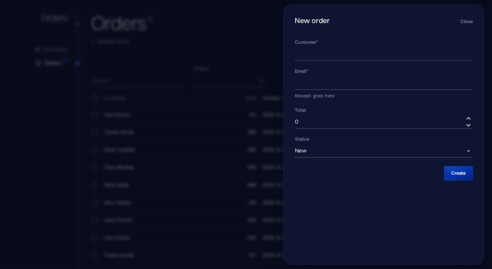

# Диалоги и формы

[English](../en/forms.md) · [Русский](forms.md) · [Документация](README.md)

## Диалоги

```csharp
if (await Dialogs.ConfirmAsync("Delete the order?", "The customer is notified.", "Delete", danger: true))
    await Store.DeleteAsync(order);

var sheet = await Dialogs.ShowSheetAsync<OrderForm>("New order");
var result = await sheet.Result;
```

`ShowSheetAsync` открывает боковую панель на десктопе и нижнюю на телефонах. При `form: true` (по умолчанию) клик за пределами панели её не закрывает. Для панели с данными только для чтения передайте `form: false`. Компонент панели оборачивает свою разметку в `Sheet`, у которого есть `ChildContent` и `Actions`.

Для простого подтверждения перед действием короче `Button` с `Confirm`; см. [Действия](actions.md).

## Формы

```razor
<Sheet>
    <Form Model="_order" OnSubmit="SaveAsync" Submit="Create" Done="Order created">
        <Field For="() => _order.Customer" />
        <Field For="() => _order.Total" />
        <Field For="() => _order.Status" />
    </Form>
</Sheet>

@code {
    private readonly OrderDraft _order = new();

    private Task SaveAsync() => Store.CreateAsync(_order);
}
```

```csharp
var order = await Dialogs.ShowFormAsync<OrderSheet, OrderDraft>("New order");
```



`Form` проверяет модель по атрибутам данных, показывает занятую кнопку отправки и отправляет один раз по Enter. После успеха он сообщает `Done`, перезагружает блоки страницы, а внутри панели закрывает её и возвращает модель, которую отдаёт `ShowFormAsync`; закрытая панель возвращает `null`.

Модель — обычный класс с атрибутами:

```csharp
public sealed class OrderDraft
{
    [Required, Display(Name = "Customer", Description = "As on the invoice")]
    public string Customer { get; set; } = "";

    [Range(1, 100_000)]
    public decimal Total { get; set; }

    public OrderStatus Status { get; set; }
}
```

## Ошибки и несохранённые изменения

- `OnSubmit` бросает `FieldException(field, message)` или `FieldException(errors)` для ошибок рядом с полями; они исчезают, когда поле меняется.
- `PanelException` или [зарегистрированное](errors.md) исключение показывает своё сообщение над кнопкой; любое другое показывает общее сообщение и попадает в лог.
- Изменённая форма спрашивает подтверждение перед закрытием панели (кнопка закрытия или Escape) и перед уходом со страницы. Изменение — это любое отличие от модели в том виде, в каком она была передана форме или сохранена в последний раз; сравнение идёт по JSON-снимку, поэтому добавленные или удалённые строки коллекции считаются, а значение, возвращённое назад, нет. Свойство с `[JsonIgnore]` в сравнение не входит. Чтобы начать заново, передайте форме новый экземпляр модели.
- `IsDirty` у `@ref` сообщает, есть ли в форме изменения, например перед переключением представлений внутри страницы, которое навигацией не является.
- Внутри `Form` работает любой ввод MudBlazor с `For=`, а сама `Form` работает и на странице, например в настройках.

## Параметры Form

| Параметр         | Описание                                                        |
| ---------------- | --------------------------------------------------------------- |
| `Model`        | Редактируемый объект.                                           |
| `OnSubmit`     | Вызывается с валидной моделью.                                  |
| `Submit`       | Текст кнопки отправки. По умолчанию «Save».                   |
| `Done`         | Сообщение после успеха. По умолчанию «Saved».                 |
| `Refresh`      | Перезагружает блоки страницы после успеха. По умолчанию `true`. |
| `Actions`      | Дополнительные кнопки перед кнопкой отправки.                   |

## Поля

`Field` выбирает ввод по типу свойства, подпись берёт из `[Display(Name)]` (ресурсы тоже подходят), подсказку из `[Display(Description)]`, а отметку обязательности из `[Required]`.

| Тип                                     | Ввод                                                     |
| --------------------------------------- | -------------------------------------------------------- |
| `string`                              | Текст; `Lines` для нескольких строк, `Secret` для пароля. |
| Числа                                   | Числовое поле.                                           |
| `bool`, `bool?`                     | Переключатель, флажок с тремя состояниями.               |
| Перечисления или любой тип с `Options` | Выбор с `[Display(Name)]` каждого члена.               |
| `DateOnly`                            | Дата.                                                    |
| `DateTime`, `DateTimeOffset`        | Дата и время в часовом поясе зрителя, сохраняются в UTC. |

| Параметр         | Описание                                                        |
| ---------------- | --------------------------------------------------------------- |
| `For`          | `() => _order.Customer`.                                      |
| `Label`, `Hint` | Переопределяют атрибуты.                                     |
| `Options`      | Варианты `Option(Value, Title)`, например для `string`.     |
| `Lines`, `Secret`, `Disabled` | Настройки текстового ввода.                      |

Для другого типа поле падает с сообщением, которое отправляет к вводам MudBlazor.
