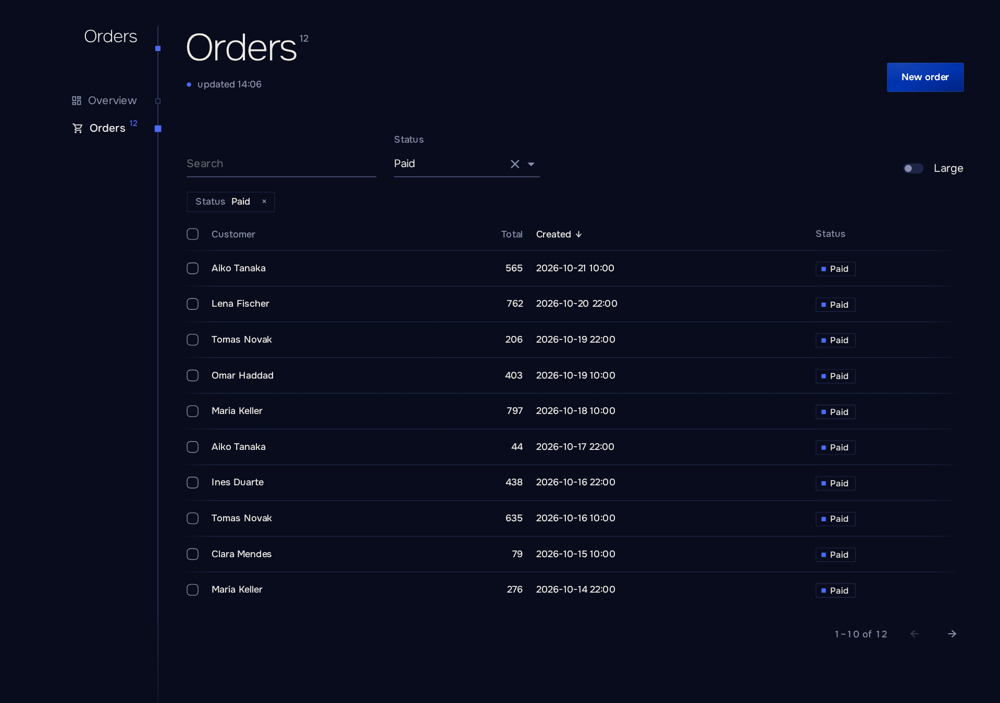

# Списки

[English](../en/listings.md) · [Русский](listings.md) · [Документация](README.md)

`Listing` показывает таблицу с сортировкой, постраничным выводом, фильтрами и состояниями загрузки, пустоты и ошибки. Его состояние живёт в адресе, поэтому ссылку на отфильтрованную страницу можно отправить коллеге.

```razor
<PageHead />
<Listing TItem="Order" Load="Store.PageAsync" Sort="-createdAt" Href="@(order => $"orders/{order.Id}")">
    <Columns>
        <Cell Title="Customer" Value="order => order.Customer" Sort />
        <Cell Title="Total" Value="order => order.Total" Sort />
        <Cell Title="Created" Value="order => order.CreatedAt" Sort />
        <Slot Title="Status"><Tag Tone="ToneOf(context)">@context.Status</Tag></Slot>
    </Columns>
</Listing>
```



## Загрузка данных

Серверный `Load` получает `ListQuery<TItem>` с уже разобранными выражениями, поэтому хранилище над `IQueryable` (в том числе EF Core) умещается в одну строку:

```csharp
public Task<ListPage<Order>> PageAsync(ListQuery<Order> query, CancellationToken token) =>
    Task.FromResult(db.Orders.ToPage(query));
```

`Filter(query)` применяет условия, `Slice(query)` — порядок и страницу, `ToPage(query)` — и то и другое, плюс подсчёт. Для других хранилищ запрос несёт и сырые значения: `Page`, `Size`, `Search`, `Sort` (`Key`, `Descending`) и `Filters` по имени.

Если передать `Items` вместо `Load`, список сам отсортирует, отфильтрует и разобьёт на страницы коллекцию в памяти.

| Параметр         | Описание                                                                                     |
| ---------------- | -------------------------------------------------------------------------------------------- |
| `Load`         | `(ListQuery<TItem>, CancellationToken) => Task<ListPage<TItem>>`. Новая загрузка отменяет старую. |
| `Items`        | Коллекция в памяти. Нужен ровно один из `Load` и `Items`.                                |
| `Columns`      | Компоненты `Cell` и `Slot`.                                                              |
| `Href`         | Ссылка строки: работают средняя кнопка мыши и «открыть в новой вкладке».                   |
| `OnOpen`       | Вызывается с элементом строки по клику или Enter, например чтобы открыть панель.             |
| `Sort`         | Ключ сортировки по умолчанию, `-` для убывания: `"-total"`.                              |
| `PageSize`     | Строк на странице, не меньше `1`. По умолчанию `25`.                                       |
| `Name`         | Префикс ключей адреса для двух списков на одной странице: `orders.page`.                   |
| `Empty`        | Содержимое, когда данных ещё нет.                                                            |
| `Dense`        | Более плотные строки.                                                                        |

## Колонки

`Cell` показывает значение, отформатированное через `ViewerTime.Of`: числа, деньги, даты в часовом поясе зрителя, длительности, `bool` и перечисления с `[Display(Name)]`.

| Параметр         | Описание                                                                                     |
| ---------------- | -------------------------------------------------------------------------------------------- |
| `Title`        | Заголовок колонки.                                                                           |
| `Value`        | `order => order.Total`. Путь к члену в camelCase служит ключом сортировки в адресе.       |
| `Sort`         | Делает колонку сортируемой. Для вычисляемого `Value` нужен ещё и `Key`.                  |
| `Number`       | Выравнивает колонку вправо. По умолчанию включено для числовых значений.                    |
| `Format`       | Собственное форматирование значения.                                                         |
| `ChildContent` | Шаблон с `context`; значение по-прежнему сортируется.                                      |

`Slot` — колонка только из шаблона, например с действиями; она никогда не сортируется.

## Фильтры

```razor
<Listing TItem="Order" Load="Store.PageAsync" SearchBy="[order => order.Customer, order => order.Email]">
    <Filters>
        <Search />
        <Choice Title="Status" By="order => order.Status" Options="Statuses" />
        <Flag Title="Large" Name="large" Where="order => order.Total > 1000" />
    </Filters>
    <Columns>...</Columns>
</Listing>
```

Активные фильтры показываются как `Crumb`, которые их снимают. Если фильтры ничего не оставили, список говорит об этом и даёт ссылку на адрес без них. Смена фильтра возвращает на первую страницу.

| Фильтр    | Параметры                                                                                                                        |
| --------- | -------------------------------------------------------------------------------------------------------------------------------- |
| `Search` | `Placeholder`. Поиск «содержит» без учёта регистра по `SearchBy` списка, после паузы в наборе 300 мс; заменяет запись в истории, а не добавляет новую. Спискам в памяти нужен `SearchBy`; серверный `Load` без него получает текст в `query.Search`. |
| `Choice` | `Title`, `By` (`order => order.Status`), `Options` (`Option(Value, Title)`), `Name` (по умолчанию путь к члену из `By`). |
| `Flag`   | `Title`, `Name`, `Where` (`order => order.Total > 1000`). Включённый — это `name=1` в адресе.                              |

Два фильтра с одним именем падают при первом рендере. Значение из адреса, которому не соответствует ни одна опция, игнорируется.

## Адрес

Ключи адреса: `page`, `sort`, `q` и имена фильтров. При `Name="orders"` они превращаются в `orders.page`, `orders.sort` и так далее.

Вручную исправленный адрес страницу не ломает: неверный номер страницы открывает первую, номер за пределами — последнюю, неизвестный ключ сортировки возвращает сортировку по умолчанию. Сортируемая ячейка без пути к члену падает при первом рендере с сообщением, в котором названа эта ячейка.

## Выбор строк и свежесть

```razor
<PageHead />
<Listing TItem="Order" Load="Store.PageAsync" ItemKey="order => order.Id" Selectable Live>
    <Selected>
        <Button Kind="ButtonKind.Danger" OnClick="() => Store.CancelAsync(context)" Done="Orders cancelled">Cancel</Button>
    </Selected>
    <Columns>...</Columns>
</Listing>
```

| Параметр     | Описание                                                                                                  |
| ------------ | --------------------------------------------------------------------------------------------------------- |
| `Selectable` | Добавляет флажки. Выбор относится к текущей странице и сбрасывается при смене страницы, сортировки или фильтров. |
| `Selected`   | Панель над таблицей, пока выбраны строки; `context` — выбранные элементы.                                |
| `ItemKey`    | Что идентифицирует строку, чтобы выбор пережил перезагрузку: `order => order.Id`. По умолчанию сам элемент, что работает только для элементов, сравниваемых по значению, например records; для выбираемого списка с `Load` и другими классами параметр обязателен. |
| `Live`       | Перезагружает список каждые `AutoRefreshInterval`, пока вкладка видна.                                    |

`PageHead` без `Count` и `UpdatedAt` следует за страницей: он показывает итог и время последней загрузки первого списка на странице, а его отметка обновления перезагружает все списки. Действие через `Button` или `Act` перезагружает их тоже.

Первая загрузка показывает скелетон; повторная оставляет строки на экране; неудачная показывает сообщение и кнопку «повторить» внутри списка, пока остальная страница продолжает работать. Сообщение — это текст самого исключения, если оно [показывается пользователям](errors.md), и общее в остальных случаях. Чтобы перезагрузить из кода, вызовите `RefreshAsync()` у `@ref`.
