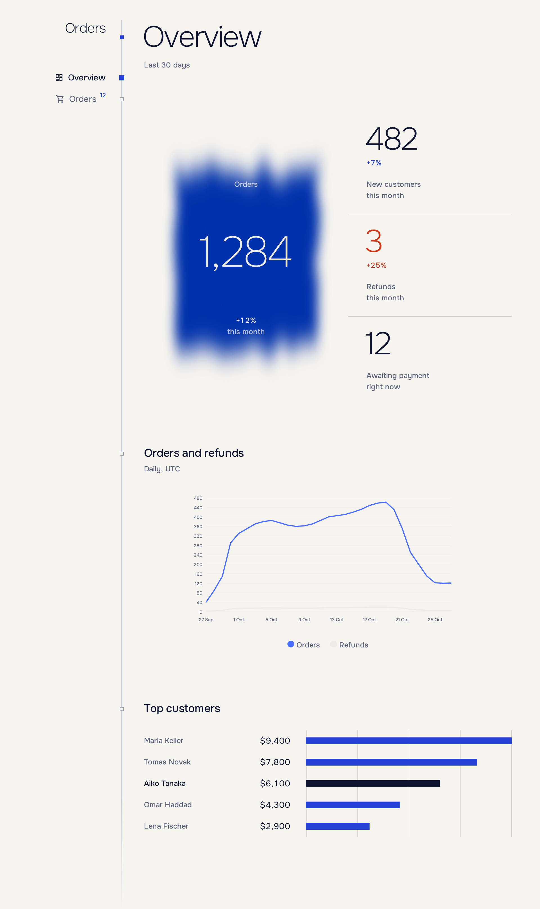

# Оформление

[English](../en/styling.md) · [Русский](styling.md) · [Документация](README.md)

По умолчанию тема тёмная; `Light` и `System` включаются одной опцией.

```csharp
builder.Services.AddEnfilade(shell =>
{
    shell.Appearance = Appearance.System;
    shell.Accent = "#2F5BFF";
});
```



## Токены дизайна

Токены дизайна — это CSS-переменные: `--night`, `--deep`, `--rule`, `--mist`, `--light`, `--klein`, `--glow`, `--vermilion`, `--ochre`, `--sans`, `--mono`. При `Appearance`, равном `Light` (или `System` на светлом устройстве), они сохраняют имена и получают светлые значения: `--night` становится светлым фоном, а `--light` — тёмным текстом.

Используйте токены в собственных стилях, и они будут следовать теме:

```css
.callout {
    border: 1px solid var(--rule);
    background: var(--deep);
    color: var(--light);
}
```

`Accent` заменяет фирменный цвет (`--klein`) вашим `#RRGGBB`. Стили добавляются через `AddStylesheet(path)`; изолированный CSS разделов подключается автоматически.

## Классы

| Класс                                         | Назначение                                       |
| --------------------------------------------- | ------------------------------------------------ |
| `btn-k pigment`                             | Основная кнопка.                                 |
| `btn-danger`                                | Кнопка разрушающего действия.                    |
| `link`                                      | Тихая текстовая кнопка.                          |
| `tbl`, `tbl dense`                        | На `MudTable`. `num` добавляется числовым колонкам. |
| `empty`                                     | Пустое состояние; его рисует `EmptyState`.     |
| `block`, `lead`                           | Блок с заголовком ниже по странице; заменяются `Pane`. |
| `group`, `pair`, `hint`, `form-error` | Разметка формы внутри панели.                    |
| `note`, `warn-t`, `bad-t`               | Второстепенный текст, предупреждение и ошибка.   |
| `sr`                                        | Виден только программам чтения с экрана.         |

## Доступность

- После навигации фокус переходит на заголовок страницы.
- Макеты учитывают безопасные зоны экрана, грубые указатели и `prefers-reduced-motion`.
- Показатели и метки фильтров несут текст для программ чтения с экрана; `sr` делает то же для вашей разметки.
